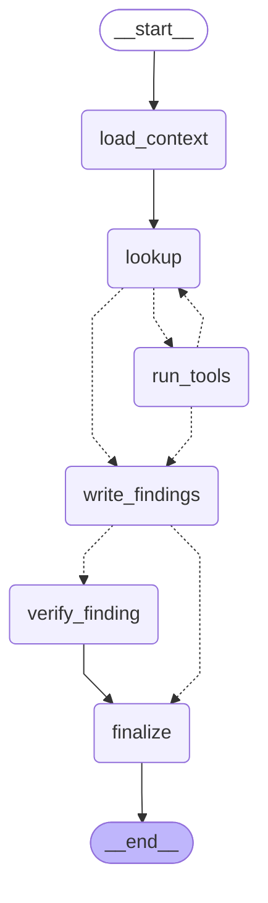

# Architecture

The review of one changed file is a LangGraph state graph. This diagram is generated from the compiled graph by `scripts/draw_graph.py`; do not edit it by hand.

| Node | LLM calls | What it does |
|------|-----------|--------------|
| `load_context` | 0 | Reads the diff of the file and `AGENTS.md` at the reviewed commit and starts the conversation. |
| `lookup` | 1 per round | The model asks for read-only tools, or says it has enough context. |
| `run_tools` | 0 | Runs the requested tool calls while the budget lasts and refuses the rest. |
| `write_findings` | 1 | Turns the conversation into a structured list of draft findings. |
| `verify_finding` | 1 per finding | Checks one finding against the code again, in a fresh context. The findings are checked in parallel. |
| `finalize` | 0 | Splits the checked findings into reported and dropped ones and sorts them. |

A solid arrow is a fixed edge. A dotted arrow is a conditional edge: `lookup` goes to `run_tools` when the model asked for tools, `run_tools` goes back to `lookup` while tool budget is left, and `write_findings` starts one `verify_finding` per draft finding, or goes straight to `finalize` when there is none.
