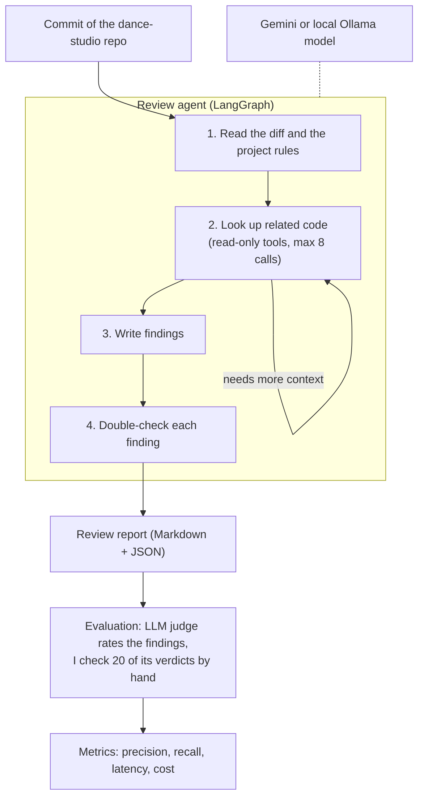

# ReviewGraph: a LangGraph code-review agent for an AI-written Django app

Mária Bekő-Révai (H81S2G) - marcsika96@gmail.com

## Introduction

My dance-studio web application (Django, ~6,000 lines of application code) was written almost entirely by AI coding agents, in eight increment commits (I1–I8) that I still have to review. ReviewGraph is a command-line agent that reviews a commit of this repository, gathers context with read-only tools, and reports concrete defects. It is built with LangGraph (new) on LangChain, the Gemini API and Ollama, and is evaluated on the real increment commits: an LLM judge rates every finding, and I check a sample of its verdicts by hand. The application is my project for another course; here it is only the review target, and the reviewer is new work.

## Main objectives

For a developer who wants a second opinion on an AI-written change before accepting it. Minimum scope:

1. **Review**: `reviewgraph review --repo <path> --commit <sha>` reviews the Python files under `app/studio/` that a commit changes and outputs findings (file, line, category, severity, explanation, fix) as Markdown and JSON.
2. **Context**: besides the diff, the agent can open other files, search the code and read the project rules in `AGENTS.md`. It sees the repository as it was at the reviewed commit, it can only read files, never change them, and it may use these tools at most 8 times per review.
3. **Self-check**: each finding is re-checked against the code, and unsupported findings are dropped.
4. **Free path**: Gemini free tier by default, a local Ollama model as an alternative (`LLM_PROVIDER`). Cached evaluation outputs let the report be reproduced without a key.
5. **Evaluation**: `reviewgraph eval` reviews every test unit with each system, has the LLM judge rate every finding, and computes the metrics.
**Optional**: post the review as a pull-request comment.

Error cases: an unknown commit, or one without reviewable Python, is answered without an LLM call; API errors are retried with backoff, then reported; invalid structured output is retried once. 
Out of scope: templates, JavaScript, auto-fixing, other repositories. 

## Data sources

| Source | Access | License | Size | Use |
| --- | --- | --- | --- | --- |
| dance-studio-webapp, increment commits I1–I8 (`29949a3` to `e594bc8`) | [GitHub](https://github.com/marcsika96/dance-studio-webapp), read access for the instructors; `scripts/get_target.py` clones it | Own work; vendored htmx (0BSD) and FullCalendar (MIT) are excluded | 307 files; I1–I8 add ~2,900 lines of application Python | Review target and tool context |
| Review units, judge verdicts and my hand checks (created for this project) | `data/` in the homework repository | Own work | 62 units, ~200 verdicts, 20 hand checks, < 1 MB | Evaluation |

A **review unit** is one changed Python file in one increment commit, reviewed with the repository as it was at that commit, so later code cannot leak in. Each increment is one commit; where follow-up commits exist (I5, I6), the first one, which holds the generated code, is used. Units are the files under `app/studio/` with at least 15 added lines, excluding migrations and seed data: **26 dev units** from I1–I3 (only for tuning the reviewer and judge prompts) and **36 test units** from I4–I8 (I4: 6, I5: 10, I6: 3, I7: 7, I8: 10), frozen before the first test run.

## Architecture

The agent works in four steps. It reads the changed lines and the project rules, then looks up related code (opening files, searching the code) until it has enough context or has used its 8 tool calls. It then writes its findings and finally double-checks each one against the code, dropping the ones it cannot support. In LangGraph each step is a node, and the look-up step is a loop in the graph. The tools see the repository as it was at the reviewed commit and cannot change or run anything. The baseline skips steps 2 and 4: it gets only the diff and the rules and answers in a single prompt.

## Used technologies

| Technology | Origin | Purpose in the project |
| --- | --- | --- |
| LangGraph | new | Builds the agent as a graph of steps: the data shared between the steps, the look-up loop with its limit of 8 tool calls, choosing the next step from the result, and double-checking the findings in parallel |
| LangChain 1.x | course (lab 3) | Chat-model interface, `@tool` definitions, `with_structured_output`, token usage |
| Gemini API | course (lab 3) | Reviewer and judge LLM: `gemini-3.5-flash` on the free tier, through `langchain-google-genai` |
| Ollama | course (lab 3) | Local model (e.g. `qwen2.5-coder:7b`) through `langchain-ollama`, as a key-free path |
| Pydantic | course (lab 3) | Schemas for findings, units and judge verdicts; validated structured output |
| Git, pytest, python-dotenv | tooling | Reading the repository at a commit; smoke tests; configuration from `.env` |

Versions are pinned to the tested lab 3 environment (`langchain` 1.4.2, `langgraph` 1.2.12, `langchain-ollama` 1.1.0, `pydantic` 2.13.5).

**Why LangGraph is essential.** In lab 3, LangGraph only worked in the background, storing the memory of a `create_agent` agent. Here it is the core of the system, because the reviewer is a sequence of steps with a loop and decisions in it. `create_agent` runs one loop of "call a tool, read the result", and the router of lab 3 picks a branch only once, so neither can do "look up code until there is enough context, then write findings, then double-check each one". Without LangGraph I would have to write this control flow myself: the loop and its limit, passing the data from step to step, and the parallel double-check.
## Evaluation plan

- **Test set**: the 36 test units from I4–I8. Temperature 0, one run per unit and system.
- **What is compared**: (A) my agent with all four steps, and (B) a simple baseline that uses the same model and project rules but gets only the changed lines and answers in a single prompt, without looking up code or double-checking. The difference between A and B shows what the extra steps add.
- **Judging** (LLM-as-a-judge, lecture 9): a separate judge prompt on `gemini-3.5-flash` rates every medium- or high-severity finding of A and B (at most 3 per unit and system) as *valid* (a defect that changes behaviour or breaks a rule of `AGENTS.md` or the model), *minor* (true but cosmetic; not counted) or *invalid*, with a one-sentence reason. It sees the finding, the diff, the whole file at the commit and the rules, but not which system produced the finding. Findings in the same file with overlapping lines (±3) and the same category are merged into one defect.
- **Metrics**: precision (valid ÷ judged findings); pooled recall (distinct valid defects a system found ÷ all distinct valid defects found by either system); F1 as the primary metric; the share of units with at least one valid finding; a breakdown by category.
- **Latency and cost**: wall-clock time per review (median, p95), LLM and tool calls, and tokens priced at Gemini's paid-tier rate as USD per review. Total spend, judge included, is expected to stay under USD 5.
- **Hand check**: I judge 20 findings myself before seeing the judge's verdicts (10 per system, mixed across categories) and report how often the judge agrees with me. I analyse at least three failures, for example a confident false alarm, a defect only the baseline found, or a judge verdict I disagree with.
- **Hypothesis**: the agent finds more valid defects than the baseline where context from other files is needed (authorization, transactions, model rules), and reports fewer invalid findings. Threats to validity: pooled recall cannot count defects that neither system finds, and a judge from the same model family may be lenient towards the reviewer, which the hand check measures.
